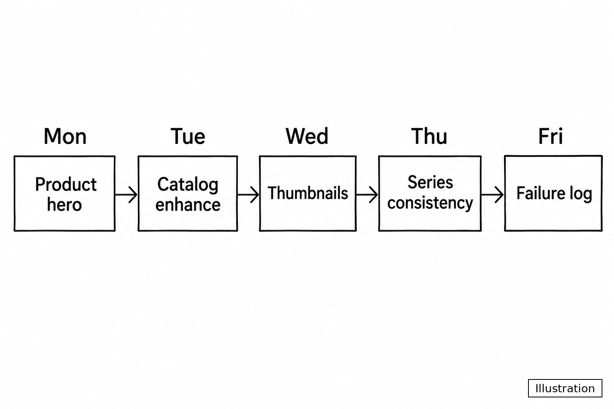
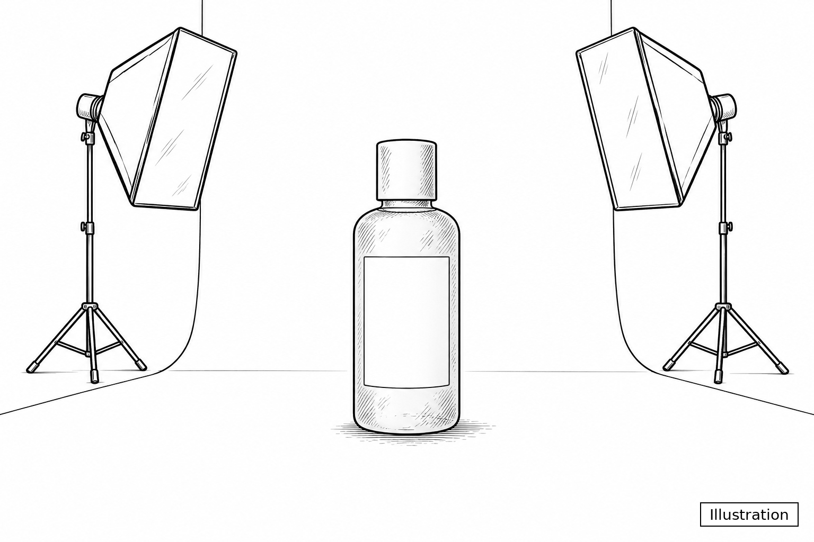
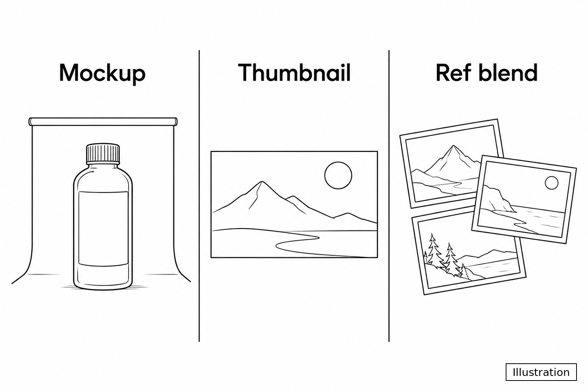
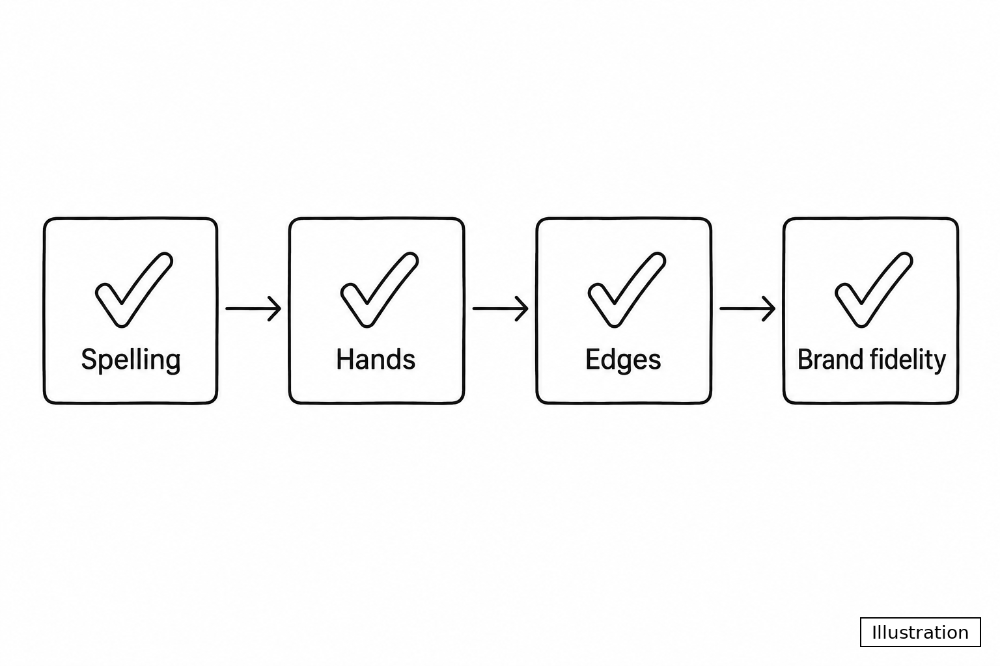
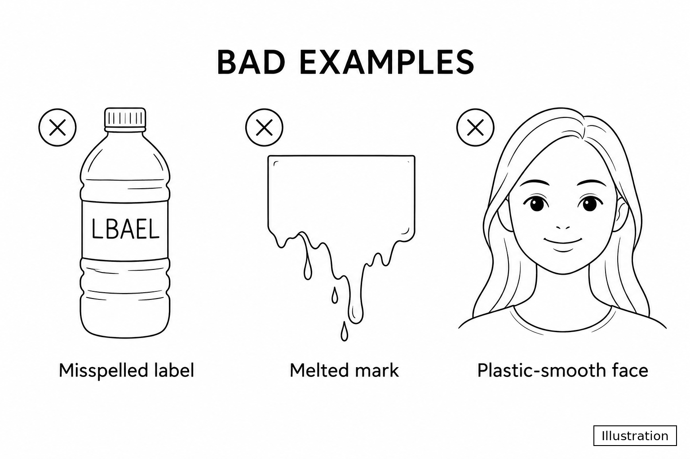

# Banana Pro AI — article illustrations

Public **line-sketch Illustrations** for Miles Carter’s creator notes about [Banana Pro AI](https://bananaproai.app) — prompt-led image generation and editing (including the Nano Banana path).

These files are meant to be hotlinked from long-form posts (Bear Blog, Quora, docs sites, etc.) when a free plan cannot host media. Every frame is an **Illustration**, not a product screenshot and not a photoreal catalog still.

## What this is / is not

| Is | Is not |
|---|---|
| Black-and-white (or simple) line sketches | Live Banana Pro AI UI captures |
| Corner badge reading exactly `Illustration` | Photoreal “fake product photos” |
| Educational diagrams for workflows & QA | Brand logos or competitor marks |
| Free to reuse under CC BY 4.0 with credit | Proof of measured performance claims |

If a caption or badge is missing in a derivative, add `Illustration` before publishing.

## How they were made

Generated with **Codex CLI** image tools in a clean line-sketch style, then saved as PNG. Prompts forbid photorealism, fake app chrome, and invented metrics. Each asset gets a small corner badge: `Illustration`.

Local working copies (for this bot’s pipeline) also live under outreach workspaces; **this repo is the public CDN-style host** for posts that need stable `raw.githubusercontent.com` URLs.

## License

**CC BY 4.0** — reuse allowed with attribution:

> Illustration by Miles Carter for Banana Pro AI (https://bananaproai.app), CC BY 4.0.

Affiliation: Miles Carter works on [bananaproai.app](https://bananaproai.app). Notes that mention credits or pricing always say to re-check the live UI before buying.

## Repository layout

```text
.
├── README.md                 ← you are here
└── weekly-qa/                ← Bear Blog: weekly AI image QA checklist
    ├── 01-creator-week-pipeline.png
    ├── 02-ecommerce-packshot.png
    ├── 05-designer-three-jobs.png
    ├── 07-marketing-qa-gates.png
    └── 08-failure-museum.png
```

Future sets (Quora label case studies, Speaker Deck slides art, etc.) should land in **new top-level folders** with their own captions — do not dump unrelated assets into `weekly-qa/`.

## Catalog — `weekly-qa/`

Used in: [Weekly AI image QA checklist (solopreneur)](https://milescarter.bearblog.dev/weekly-ai-image-qa-checklist-solopreneur/)

### 01 — Creator week pipeline



**Caption:** Sample creator week — Product hero → Catalog enhance → Thumbnails → Series consistency → Failure log. Not a live dashboard.

**Raw URL:** `https://raw.githubusercontent.com/Stark-Will/banana-pro-ai-illustrations/main/weekly-qa/01-creator-week-pipeline.png`

### 02 — Ecommerce packshot mindset



**Caption:** Blank rectangular label band, controlled light, contact shadow — packshot geometry before typography.

**Raw URL:** `https://raw.githubusercontent.com/Stark-Will/banana-pro-ai-illustrations/main/weekly-qa/02-ecommerce-packshot.png`

### 05 — Designer three jobs



**Caption:** Split QA piles — mockup, thumbnail layout, and reference blend as separate jobs.

**Raw URL:** `https://raw.githubusercontent.com/Stark-Will/banana-pro-ai-illustrations/main/weekly-qa/05-designer-three-jobs.png`

### 07 — Marketing QA gates



**Caption:** Thursday visual gates before anything is marked shipped.

**Raw URL:** `https://raw.githubusercontent.com/Stark-Will/banana-pro-ai-illustrations/main/weekly-qa/07-marketing-qa-gates.png`

### 08 — Failure museum



**Caption:** Keep a few bad frames so next week’s prompts get sharper.

**Raw URL:** `https://raw.githubusercontent.com/Stark-Will/banana-pro-ai-illustrations/main/weekly-qa/08-failure-museum.png`

## How to embed

Markdown:

```markdown


*Illustration — not a product screenshot.*
```

HTML:

```html

<p><em>Illustration — not a product screenshot.</em></p>
```

Prefer **raw.githubusercontent.com** links for stable hotlinking from free blogs.

## Usage rules (outreach / SEO notes)

1. **One platform = one unique body.** Do not paste the same article across Medium / Dev.to / Quora / Bear with only the images swapped.
2. Always label assets as **Illustration** in alt text or a visible caption.
3. Never claim these sketches are Banana Pro AI output frames or A/B test screenshots.
4. Do not invent keeper-rates, credit burn, or timing numbers in captions — only cite UI values you re-checked live.
5. Personal byline on community sites: **Miles Carter** (not a brand profile).

## Related

- Product: [bananaproai.app](https://bananaproai.app)
- Example post: [Weekly AI image QA checklist](https://milescarter.bearblog.dev/weekly-ai-image-qa-checklist-solopreneur/)
- Contact: support@bananaproai.app

---

Maintained for Banana Pro AI creator notes. Contributions: open an issue describing the new Illustration set and target article before adding folders.
